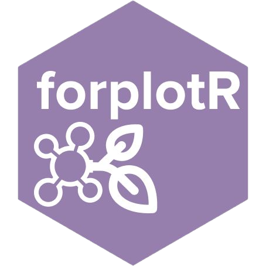

<!-- README.md is generated from README.Rmd. Please edit that file -->

```{r, include = FALSE}
knitr::opts_chunk$set(
  collapse = TRUE,
  comment = "#>",
  fig.path = "man/figures/README-",
  out.width = "100%"
)
```

# forplotR 

<!-- badges: start -->
[](https://github.com/DBOSlab/forplotR/actions/workflows/R-CMD-check.yaml)
[](https://app.codecov.io/gh/DBOSlab/forplotR)
[](LICENSE)
<!-- badges: end -->

`forplotR` streamlines field and post-field work with permanent forest plot
data. It reads [ForestPlots.net](https://forestplots.net/) field sheets and
Query Library exports, and spreadsheets of the Brazilian
[MONITORA](https://www.gov.br/icmbio/pt-br/assuntos/monitoramento/programa-monitora)
program, and turns them into interactive plot maps, collection-balance
reports, organized voucher image folders and herbarium label spreadsheets.

## Installation

Install the development version from [GitHub](https://github.com/DBOSlab/forplotR):

```r
# install.packages("remotes")
remotes::install_github("DBOSlab/forplotR")
```

Saving HTML maps and reports requires [pandoc](https://pandoc.org/) (bundled
with RStudio). PDF reports additionally require a LaTeX distribution, e.g.
`tinytex::install_tinytex()`.

## Main functions

| Function | What it does |
|---|---|
| `forplot_map()` | Interactive HTML map of tagged trees, with voucher photos and filters for taxonomy and collection status |
| `forplot_balance()` | Plot- and subplot-level collection-balance maps, HTML/PDF report, species checklist and Excel summary |
| `forplot_vouchers()` | Creates and updates voucher image folders organized by family and species |
| `forplot_sheets()` | Fills a herbarium label spreadsheet (JABOT, BRAHMS or custom) from field data |
| `forplot_crossdet()` | Cross-checks field determinations against a JABOT herbarium Darwin Core Archive |

All functions accept `input_type = "field_sheet"`, `"field_sheet_ti"`,
`"fp_query_sheet"` or `"monitora"` (`forplot_sheets()` uses `"forestplots"` or
`"monitora"`). Output is written to `dir`; when `dir` is not supplied, files go
to a temporary directory that is removed when the R session ends.

## Quick start

The package ships two example datasets: `RUS01`, a ForestPlots.net field sheet
of a 1-ha Atlantic Forest plot, and `TUM`, MONITORA data from the Parque
Nacional Montanhas do Tumucumaque.

```r
library(forplotR)

fp <- file.path(tempdir(), "RUS01.xlsx")
openxlsx::write.xlsx(RUS01, fp)
out <- "forplotR_output"   # your output folder

# 1. Voucher image folders, organized by family and species
forplot_vouchers(fp, output_dir = file.path(out, "voucher_imgs"))

# 2. Interactive map. Corners in order: (0,0), (0,length), (width,0), (width,length)
corners <- data.frame(
  Latitude  = c(-19.9000, -19.9009, -19.9000, -19.9009),
  Longitude = c(-40.5500, -40.5500, -40.5490, -40.5490)
)
forplot_map(fp, vertex_coords = corners,
            voucher_imgs = file.path(out, "voucher_imgs"), dir = out)

# 3. Collection-balance report and Excel summary
forplot_balance(fp, plot_size = 1, subplot_size = 10, render_pdf = FALSE, dir = out)

# 4. Herbarium label spreadsheet from an empty JABOT template
forplot_sheets(fp, herb_file_path = "jabot_template.xlsx",
               majorarea = "ES", minorarea = "Santa Teresa",
               collector = "G. C. Ottino", lat = -19.9, long = -40.55,
               dir = out)
```

`forplot_sheets()` translates RAINFOR field codes (tree condition, light
exposure) into standardized, multilingual (`language = "en"`, `"pt"` or
`"es"`) herbarium notes and merges them with free-text field notes:

```text
Tree, 24.83cm DBH, with peeling bark, small buttress roots, bark with tiny
reddish plates, crown completely exposed to vertical and lateral light in a
45 degree curve. Individual #3 in the subplot 1, x = 1.5m, y = 2.5m.
```

A complete worked example is in the vignette:

```r
vignette("forplotR")
```

## Documentation

Full documentation and articles are available on the
[`forplotR` website](https://dboslab.github.io/forplotR-website/).

## Citation

```r
citation("forplotR")
```

Ottino, G. C. & Cardoso, D. (2025). *forplotR: Streamlined Forest Plot Data
Management and Visualization*. R package version 1.0.0.
<https://github.com/DBOSlab/forplotR>
